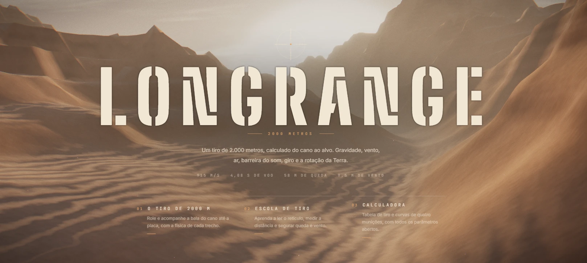
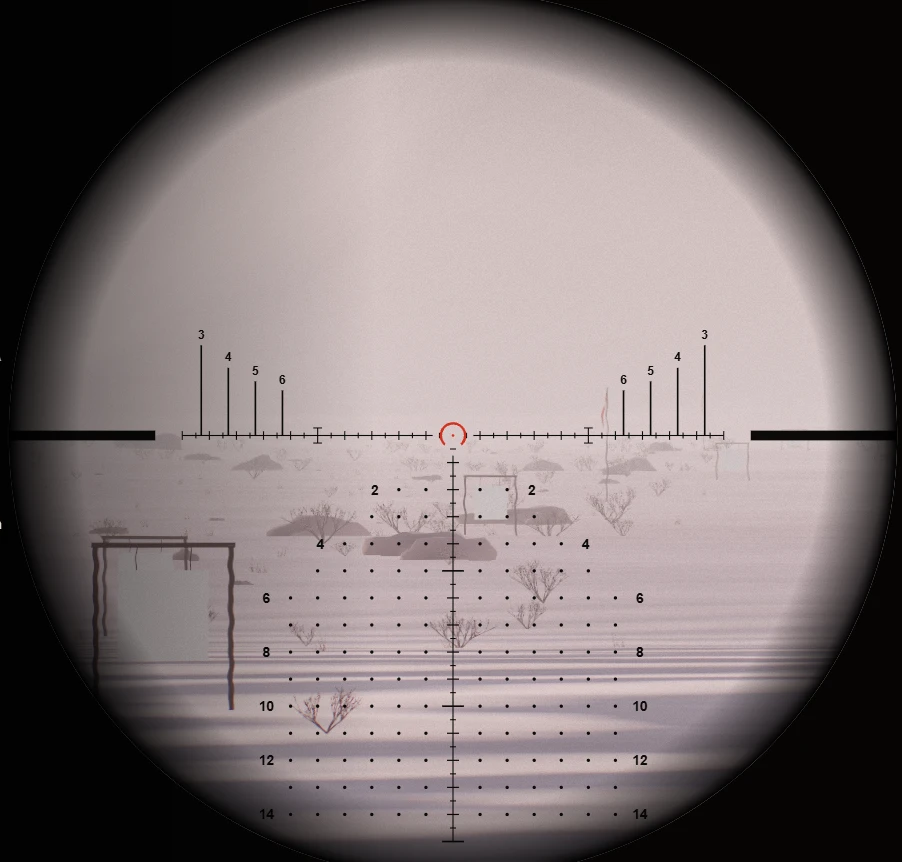
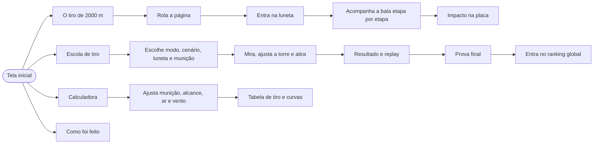
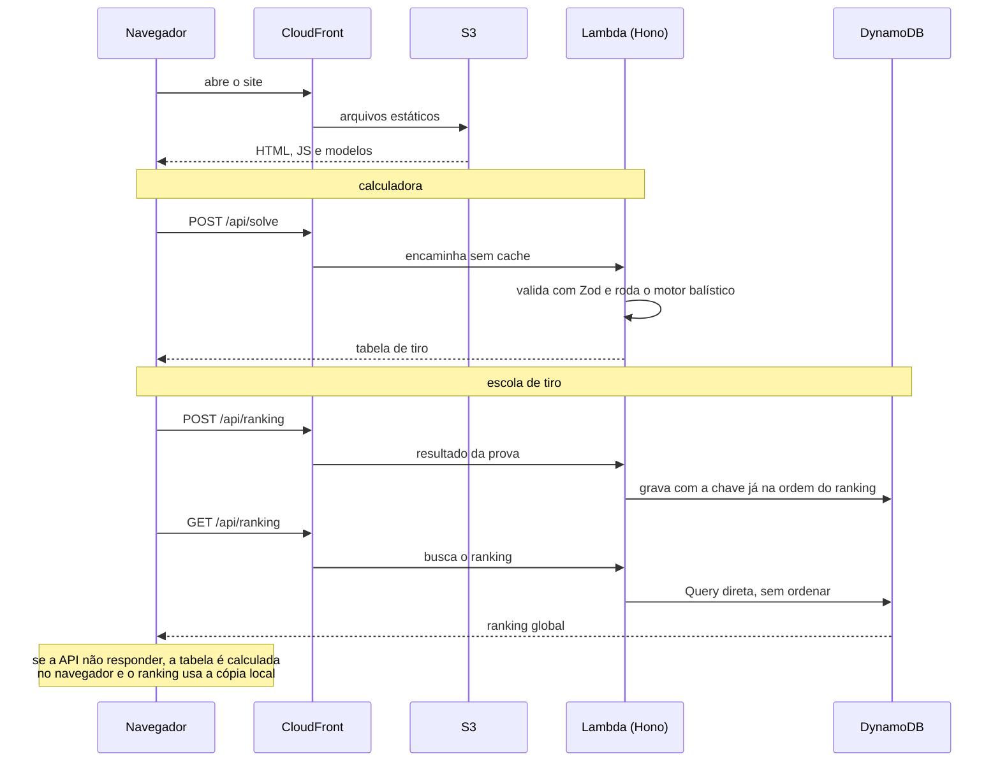
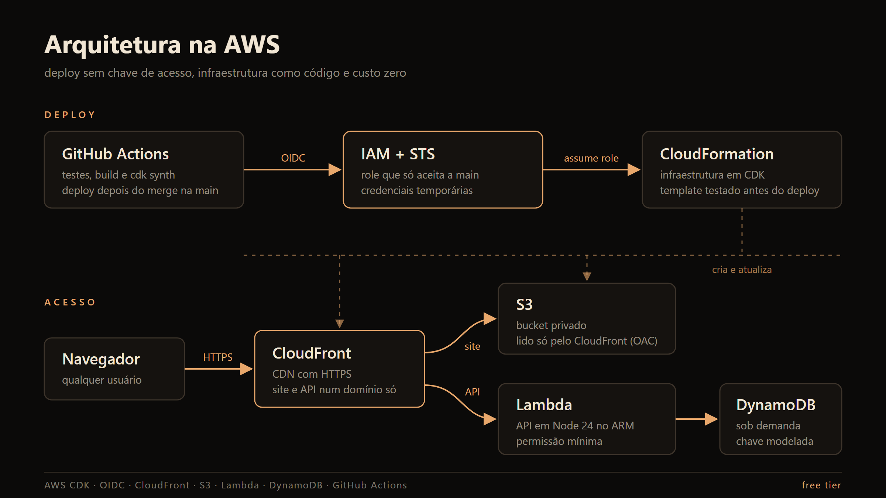

# LONGRANGE

[](https://github.com/Pedroaruana/LongRange-338/actions/workflows/ci.yml) [](https://github.com/Pedroaruana/LongRange-338/actions/workflows/deploy.yml)             

Um tiro de 2000 metros contado pelo scroll. A bala sai do cano de um .338 Lapua Magnum e atravessa um cânion no deserto até uma placa de aço, e cada trecho do voo mostra a física que está agindo naquele momento.

**No ar:** https://d1guqlezdmmti1.cloudfront.net



Nenhuma imagem ou vídeo pré-renderizado: terreno, céu, fuzil, bala, alvo, vegetação e efeitos são gerados por código em tempo real. Os números na tela saem de um motor balístico de verdade, o mesmo que roda na API.

<p align="center"></p>

## O site

- **O tiro de 2000 m**: rolando a página, a câmera sai do atirador, entra na luneta e acompanha a bala até a placa, com a fórmula de cada etapa e os valores do momento.
- **Escola de tiro**: 7 lições guiadas e treino livre, com lunetas, munições e cenários reais. Precisa de mouse e teclado.
- **Calculadora balística**: tabela de tiro e curvas de queda e velocidade de quatro munições, calculadas pela API.
- **Como foi feito**: a técnica por trás de cada parte.
- Português e inglês.

## Stack

| Camada | Tecnologia | Para quê |
|---|---|---|
| Interface | React 19, TypeScript, Tailwind 4 | telas, painéis e textos bilíngues |
| 3D | Three.js, React Three Fiber, postprocessing | cena do cânion, shaders GLSL próprios, miragem e bloom |
| Build | Vite 8 | servidor de desenvolvimento, build e geração do robots e do sitemap |
| Física | TypeScript puro em `shared/` | motor balístico usado pelo site e pela API |
| API | Hono, Zod | rotas, validação de entrada e erros padronizados |
| Dados | DynamoDB | ranking global da escola de tiro |
| Infraestrutura | AWS CDK, CloudFront, S3, Lambda | tudo como código, dentro do free tier |
| Qualidade | Vitest, Playwright | testes de física, API, infra e navegação |
| Entrega | GitHub Actions com OIDC | CI em todo PR e deploy automático na AWS |

## Fluxo do usuário



## Fluxo de dados

O motor balístico é o mesmo arquivo no navegador e na Lambda. A cena 3D calcula localmente, porque precisa de um ponto por metro a cada quadro; a tabela da calculadora e o ranking passam pela API, com o navegador como plano B.



## A física

`shared/ballistics.ts` integra a trajetória de massa pontual (RK2, passo de 0,4 ms) com:

- arrasto pela tabela padrão **G7**, com densidade do ar e velocidade do som calculadas da temperatura e da pressão;
- **vento** cruzado aplicado na velocidade relativa ao ar;
- **Coriolis** completo, `a = -2 Ω × v`, para a latitude e a direção do tiro;
- **spin drift** pela fórmula empírica de Litz.

Antes do disparo o solver encontra a elevação e a correção lateral que levam a bala ao centro da placa. Depois roda a mesma trajetória sem vento, sem Coriolis e com ar padrão, para isolar quanto cada efeito contribui.

Resultado para .338 LM 250 gr, 915 m/s, G7 0,310, 31 °C, 912 hPa, vento de 5 m/s, latitude 36° N:

| | |
|---|---|
| elevação | 27,6 mrad |
| tempo de voo | 4,08 s |
| transônica / subsônica | 1339 m / 1583 m |
| queda total | 58 m |
| deriva do vento | 9,5 m |
| spin drift | 1,4 m |
| Coriolis | 28 cm |

O motor fica em `shared/` porque é usado pelo site e pela API: os dois sempre dão o mesmo número.

## Escola de tiro

O fuzil está zerado em 100 m e a correção é segurada no retículo ou girada na torre, como num campo de tiro real.

- **Cenários**: deserto, montanha a 3.000 m com neve, campo nublado, salinas ao amanhecer e deserto à noite. Cada um muda luz, céu e cores, e também temperatura, pressão e vento, que entram na balística.
- **Lunetas**: tática 5-25× FFP com árvore de Natal em mrad, precisão 4-16× FFP com mil-dot, competição 6-24× SFP em MOA (as marcas só valem no aumento máximo, como na vida real) e caça 3-9× com duplex, onde toda correção vai na torre.
- **Munições**: .338 Lapua Magnum, .308 Winchester, 6.5 Creedmoor e .50 BMG.
- **Controles**: clique na luneta para mirar, clique atira, roda muda o aumento, W/S/A/D giram as torres, espaço prende a respiração, V mostra o replay. Na lição de distância, as teclas 3 a 6 respondem sem soltar a mira.
- **Lições**: o miliradiano, medir a distância, segurar a queda, ler o vento, girar a torre, alvo em movimento e uma prova com pontuação.
- **Ranking global** da prova pela API, com cópia no navegador quando a API está fora.

## A cena

- **Luneta**: retículos em SVG com escala em mrad calculada a partir do campo de visão da câmera; miragem de calor em pós-processamento, correndo na direção do vento.
- **Terreno**: malha não uniforme, mais densa no corredor do tiro; o shader pinta a areia em várias escalas, sempre perpendiculares ao vento.
- **Atmosfera**: céu, neblina e reflexos usam a mesma função de cor; o ambiente PBR é o próprio céu convertido por PMREM.
- **Fuzil e atirador**: fuzil modelado peça por peça em escala real; atirador Mixamo posado por código com IK de dois ossos e luvas modeladas no referencial do fuzil.
- **Bala**: ogiva tangente e boat tail nas medidas reais; o cone de choque usa o ângulo de Mach e some quando a bala fica subsônica.

## API

Hono em TypeScript, com validação por Zod. Em produção roda numa Lambda; localmente, com ranking em memória.

| Método | Rota | O que faz |
|---|---|---|
| POST | `/api/solve` | tabela de tiro: munição, alcance, temperatura, pressão, vento e zero |
| GET | `/api/ranking` | melhores resultados da prova |
| POST | `/api/ranking` | grava um resultado |
| GET | `/api/health` | checagem simples |

Entrada inválida responde 400 com a lista de campos. A descrição completa para LLMs está em [`/llms.txt`](https://d1guqlezdmmti1.cloudfront.net/llms.txt).

## Infraestrutura na AWS

Toda a infraestrutura é código (AWS CDK em `infra/`) e fica dentro do free tier:



- **CloudFront** serve o site e a API no mesmo domínio, sem CORS.
- **S3** privado, lido só pelo CloudFront.
- **Lambda** com permissão apenas na tabela do ranking.
- **DynamoDB** sob demanda, com a chave de ordenação já na ordem do ranking.

## Testes e CI/CD

- **Vitest**: física comparada com referências independentes (atmosfera padrão, queda no vácuo, regra de Didion), rotas da API, geração do robots/sitemap e o template da AWS.
- **Playwright**: navegação, calculadora com e sem API, ranking global e idioma num Chromium de verdade.
- **GitHub Actions**: todo PR roda tipos, testes, build, `cdk synth` e E2E. O merge na `main` publica na AWS por OIDC, sem nenhuma chave de acesso guardada, e confere se o site e a API estão no ar.

## Decisões técnicas e desafios

**Um motor balístico só, para o site e para a API.** No começo a física vivia dentro do front. Quando criei a API, não quis reescrever o cálculo do lado do servidor e arriscar os dois darem números diferentes. Movi o motor para `shared/` e passei a importar o mesmo arquivo nos dois lados. Para ter certeza de que ele está certo, não comparei com ele mesmo: escrevi testes contra referências independentes, como a atmosfera padrão, a queda no vácuo e a regra de Didion para o vento.

**Calcular no navegador ou na API.** A cena 3D precisa da posição da bala a cada metro e a cada quadro, então não faz sentido depender da rede: ela calcula localmente. Já a calculadora e o ranking passam pela API. Decidi que o site nunca pode quebrar por causa do backend: se a API não responder, a tabela é calculada no navegador e o ranking usa uma cópia local, e a tela avisa de onde veio cada dado.

**DynamoDB modelado pela leitura.** Em vez de buscar todos os resultados e ordenar no código, montei a chave de ordenação já na ordem do ranking: acertos invertidos com zeros à esquerda, depois a data. A leitura virou uma Query direta, sem ordenar nada.

**Deploy sem chave de acesso, e o erro que veio junto.** Não quis guardar access key no GitHub, então configurei OIDC com uma role que só aceita a branch principal do repositório. O primeiro deploy falhou com acesso negado. Investigando o token, descobri que o GitHub passou a identificar repositórios novos pelos IDs numéricos do dono e do repositório, e não pelo nome que eu tinha colocado na política. Em vez de afrouxar a permissão, ajustei a política para o formato que de fato chegava.

**Testar 3D num navegador sem placa de vídeo.** Os testes de ponta a ponta rodam num Chromium sem tela, que renderiza por software, e o terreno travava a página por minutos. Em vez de desistir dos testes, usei as flags que eu já tinha criado para medir desempenho e desliguei só as partes pesadas da cena. Assim os testes cobrem interface, navegação e API, e a parte visual eu confiro no navegador.

## Rodando

```
npm install
npm run dev        # site em http://localhost:5600
npm run dev:api    # API em http://localhost:8787 (o site usa pelo proxy do Vite)
npm test           # testes de unidade
npm run test:e2e   # testes no navegador (antes: npx playwright install chromium)
```
